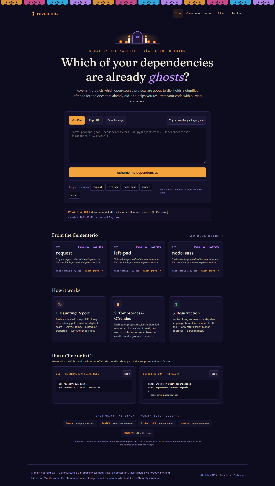
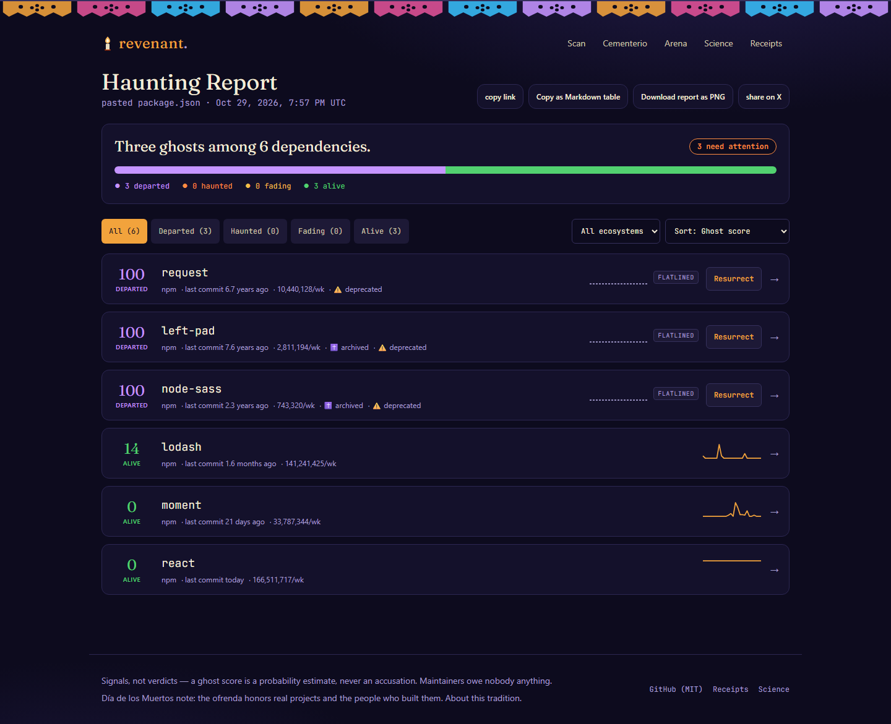
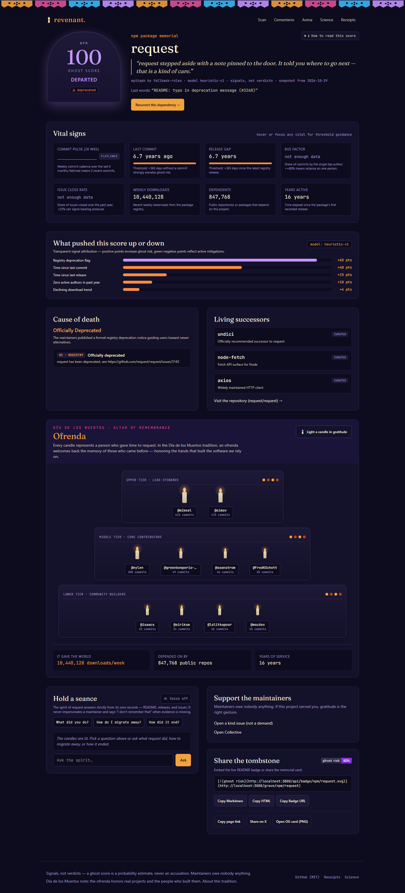
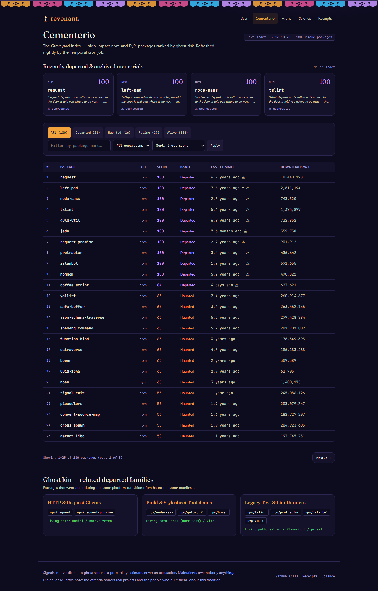

<div align="center">

# 👻 Revenant

### Which of your dependencies are already ghosts?

**Revenant predicts which open-source projects are about to die, holds a funeral for the ones that already did, and helps you resurrect your code with a living successor.**

[](https://revenantai-8hnl.onrender.com/)
[](LICENSE)
[](https://dev.to/challenges/hacktoberfest-week4-2026-10-26)

</div>

---

Two readings of "ghost in the machine" at once: zombie dependencies haunting your
dependency tree — and, in the spirit of **Día de los Muertos**, an ofrenda that honors
the projects (and people) that gave us so much before they went quiet.

> **Signals, not verdicts.** A ghost score is a probability estimate, never an accusation. Maintainers owe nobody anything.

**[Live demo](https://revenantai-8hnl.onrender.com/)** · **[Screenshots](#screenshots)** · **[What it does](#what-it-does)** · **[How it works](#how-it-works)** · **[Use cases](#use-cases)** · **[Quick start](#quick-start)** · **[Verified numbers](#verified-numbers)**

---

## Live demo

| | |
|---|---|
| 🌐 **Web app** | **https://revenantai-8hnl.onrender.com/** — no account needed, public data only |
| 📦 **CLI** | `npx revenant-cli scan .` |
| ⚙️ **Action** | `uses: SayemR0018/revenantAI@main` |
| 📄 **License** | MIT — [LICENSE](LICENSE) |

A brand-new checkout — or a free Render instance with zero env vars — boots with a fully
populated product: the seed index and showcase tombstones ship in-repo, and every missing
credential degrades to a named, honest fallback instead of a broken page.

---

## Screenshots

| Scan & land | Haunting report |
|---|---|
|  |  |

| Tombstone & Ofrenda | Cementerio index |
|---|---|
|  |  |

*Full desktop + mobile set (16 shots, verified zero horizontal scroll at 390px) in [`docs/screenshots/`](docs/screenshots/).*

---

## What it does

### 🔍 Scan

Paste a `package.json`, `requirements.txt`, or `pyproject.toml` — or scan a public repo
URL — or exhume a single package by name. The scanner streams progress per phase
(parse → resolve → signals → score → autopsy) over SSE, so a 40-dependency manifest
never looks hung. Unknown registries and missing packages degrade to an explicit
**Unknown** band instead of a fake green.

### 📊 Haunting Report

Every dependency gets a **ghost score (0–100)** — the estimated probability of
abandonment within 12 months — and a band: **Alive / Fading / Haunted / Departed /
Unknown**. The report page carries a stacked band-distribution bar, URL-synced
filters and sorting, humanized times ("3.6 years ago"), a copy-as-Markdown table
for pasting into PRs, a downloadable PNG card, and an inline **Resurrect** action
on every dead or dying row.

### ⚰️ Tombstones

Each departed project gets a full memorial page: **vital signs** (commit-pulse
sparkline with a flatline marker, release gap, bus factor, issue-response latency),
a **cause of death** with numbered, kind-labeled evidence items, a **score
contribution chart** showing exactly which signals pushed the score up or down
(`heuristic-v1` or `tabpfn`, always labeled), a dignified **epitaph**, the project's
**last words**, and living successors. Nonexistent packages return a real HTTP 404 —
a tombstone is never faked.

### 🕯️ Ofrenda

Under each tombstone, a three-tier altar renders every recorded contributor as a
candle scaled by commit share — papel picado across the top, marigold petals on the
steps, name cards beneath. You can **light a candle** (persisted locally, no
backend). Where contributor records are unavailable, a single candle burns with an
honest "records unavailable" note.

### 🕯️ Seance

Talk to the spirit of a project. Seance answers are **retrieval-grounded** — the
model can only speak from the project's own commit history, releases, registry
records, and docs. When the corpus doesn't contain an answer, the spirit says
*"I don't remember that"* rather than hallucinating, and every reply carries a
grounded/unverified badge plus evidence citations.

### 🌱 Resurrection

For anything dead or dying, Revenant ranks maintained successors using registry
pointers, dependency-graph data, and successor metadata — deterministically, so it
works with zero API keys — then enriches the migration plan with an LLM when one is
configured. The report stores dependency specs so the UI shows a real **manifest
diff** (remove old, add successor). The "Open PR" button stays disabled with an
honest tooltip until GitHub sign-in is genuinely configured — nothing is ever
committed without explicit human approval.

### 🪦 Cementerio

The Graveyard Index: 180 real npm + PyPI packages ranked by ghost risk, with a
"Recently departed" strip, band filter chips with live counts, sorting, debounced
search (still functional as a plain GET form without JavaScript), pagination, and
"mobile card" layout below `sm`.

### ⚔️ Arena

The same autopsy, run across open-weight models side by side — with latency bars,
precomputed real bouts labeled with their snapshot date, and accessible voting.
Judges see actual Gemma 4 output even on a zero-credential deploy.

### 🔬 Science

Dataset card, methodology, signal-attribution weights for `heuristic-v1`, live index
stats, and honest metrics — ROC-AUC/PR-AUC charts render when
`data/eval-results.json` exists, otherwise an honest date-labeled empty state.

### 🧾 Receipts

Every integration is checked live and reported in three groups — AI & agents,
data & infra, product & platform — with an honest PASS / DEGRADED / SKIPPED / FAIL
legend. A missing optional credential is **SKIPPED** with its fallback named. A real
failure is **FAIL**. Nothing is hidden, nothing is faked.

---

## How it works

```
manifest ──► parse ──► resolve repo ──► signals ──► ghost score ──► autopsy ──► report
  (GitHub ecosyste.ms registries)   (TabPFN / heuristic)  (Gemma / LoRA / rules)
                                           │
   Temporal ExhumeWorkflow (durable) ──────┘  fallback: in-process pipeline
   Mastra agents (autopsy · seance · resurrection)
   MongoDB Atlas (memory, corpus, votes) · Tiger/pgvector (hybrid retrieval)
   Render (web + worker + ml + nightly cron) · Sentry (agent tracing)
```

The pipeline resolves each dependency to its repository through
[ecosyste.ms](https://ecosyste.ms) open data (no key required), enriched by npm/PyPI
registry APIs and the GitHub API. Signals — commit cadence, release gaps, archive
status, deprecation flags, contributor counts, download/dependent curves — feed a
**TabPFN** prior-data network served from a FastAPI service (`ml/`). When the ML
service isn't configured, a fully transparent **heuristic scorer** with per-signal
point attribution takes over — the same `ScoredDep` shape, labeled honestly.

**Mastra** agents drive the prose layer: dignified autopsies, grounded seance
answers, and the resurrection workflow, all validated with Zod and falling back to
labeled rule-based output when no model key exists. A **Temporal** `ExhumeWorkflow`
makes scans durable and queryable; without a Temporal server, the identical pipeline
runs in-process — the app always tells you which mode it's in.

**Why open models:** a tool that detects abandonment shouldn't itself depend on a
service that can be deprecated out from under it. Every model on the product path is
open-weight — Gemma 4 (autopsy/seance/arena), TabPFN (ghost-risk prediction), a
Tinker LoRA on Qwen3 (epitaphs) — and `revenant-cli scan --offline` runs with the
lights and the internet off. The one closed model (Ultramarine) appears only as a
clearly labelled comparison baseline.

---

## Use cases

| When | What Revenant does |
|---|---|
| **Before you `npm install`** | Paste a manifest or one package name. See whether the project still has a pulse — commit pulse, release gap, bus factor — and who the living successors are if it doesn't. |
| **During dependency review in CI** | Drop `revenant-action` into a repo. It scans the manifest diff and warns on PRs that add haunted or departed dependencies *before* they merge — `--json` output makes it scriptable. |
| **When a dependency goes quiet** | Resurrection ranks maintained successors and drafts a migration plan with a manifest diff. Nothing is committed without your explicit approval. |
| **Auditing a repo offline** | `revenant-cli scan . --offline` runs entirely on the bundled 180-package index snapshot — no network, no keys, same `ScoredDep` output. |
| **Honoring the ecosystem** | Every departed project gets a tombstone with cited evidence and an ofrenda naming its contributors, plus links to support living maintainers — because open source is people. |

---

## Quick start

```bash
npm install
npm run seed           # optional: refresh data/seed/cementerio.json & showcase tombstones
npm run dev            # http://localhost:3000
```

**Pre-warmed seed data ships in-repo** — `data/seed/cementerio.json` (180 unique
packages) and `data/seed/tombstones/*.json` (20 showcase packages with real
epitaphs, commit pulses, and contributor records) — so a zero-config checkout shows
a populated Cementerio and working tombstones immediately. No keys are needed for
the core demo; ecosyste.ms + registry data carry it.

Optional services, each independently env-gated:

```bash
npx tsx temporal/worker.ts                              # durable scans (needs TEMPORAL_*)
cd ml && pip install -r requirements.txt && uvicorn ml.app:app   # TabPFN scorer (needs PRIORLABS_API_KEY)
```

Every env var is documented in [`.env.example`](.env.example) — GitHub token (raises
rate limits 60→5,000/hr), `GOOGLE_API_KEY` (Gemma 4 autopsies/seances/arena),
`MONGODB_URI`, `DATABASE_URL` (Tiger/pgvector), `TEMPORAL_*`, `ML_SERVICE_URL`,
Sentry, Auth0, and the remaining partner integrations.

### CLI

```bash
npx revenant-cli scan . --json        # CI-friendly
npx revenant-cli scan . --offline     # bundled index, no network
node cli/bin/revenant.js grave npm/left-pad   # ASCII tombstone for one package
```

### GitHub Action

```yaml
- uses: SayemR0018/revenantAI@main    # warns on PRs that add haunted deps
```

---

## Verified numbers

| Metric | Value |
|---|---|
| Seed index | **180** unique npm + PyPI packages, snapshot 2026-10-30 |
| Band split | **11** Departed · **16** Haunted · **17** Fading · **136** Alive (15.0% Haunted or worse) |
| Showcase tombstones | **20** pre-warmed with real epitaphs, commit pulses, contributor records |
| Accessibility | **0 axe-core violations** across all 8 routes; `scrollWidth ≤ clientWidth` at 390px |
| Integrations | **5 PASS** in [receipts.json](receipts.json) (Gemma, Mastra, ecosyste.ms, Copilot/Actions, Entire) — missing keys report SKIPPED, never faked |

Full measurement log with reproduction notes lives in
[`docs/WRITEUP_FACTS.md`](docs/WRITEUP_FACTS.md).

---

## Honest limitations

- Ghost score = P(abandoned within 12 months) on observable signals; it can't see
  contracts, day jobs, or intent. Treat it as a triage signal, not a verdict.
- Issue/PR response features are dropped in the reduced dataset build (disclosed on
  /science).
- Absence of a repo link means "unknown", not "dead".
- Tombstones are memorials for public records — they honor projects and the people
  behind them, and never mock maintainers.

---

## Credits & data

Package/repo signals: [ecosyste.ms](https://ecosyste.ms) (open data), npm registry,
PyPI, GitHub API.
Theme: Día de los Muertos — treated as honoring and remembrance, not costume. See
[/about](https://revenantai-8hnl.onrender.com/about).

## License

MIT — see [LICENSE](LICENSE).
